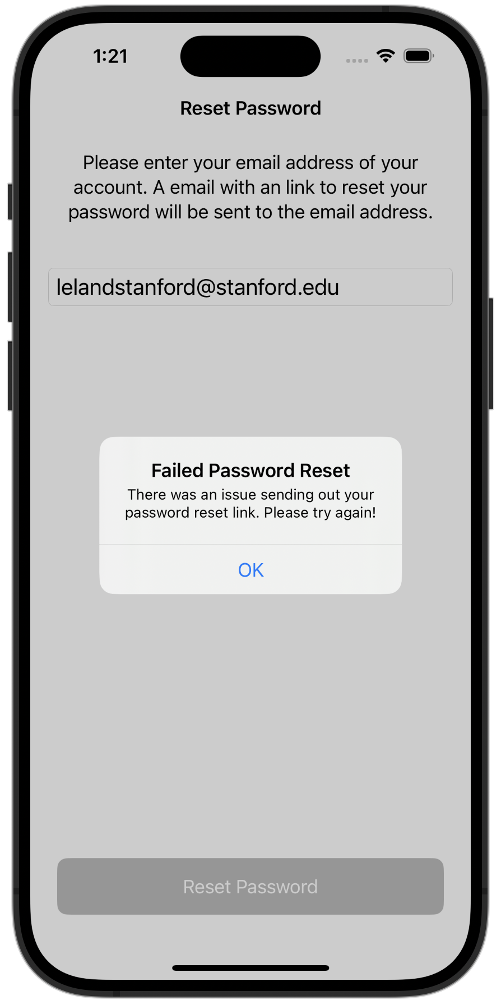
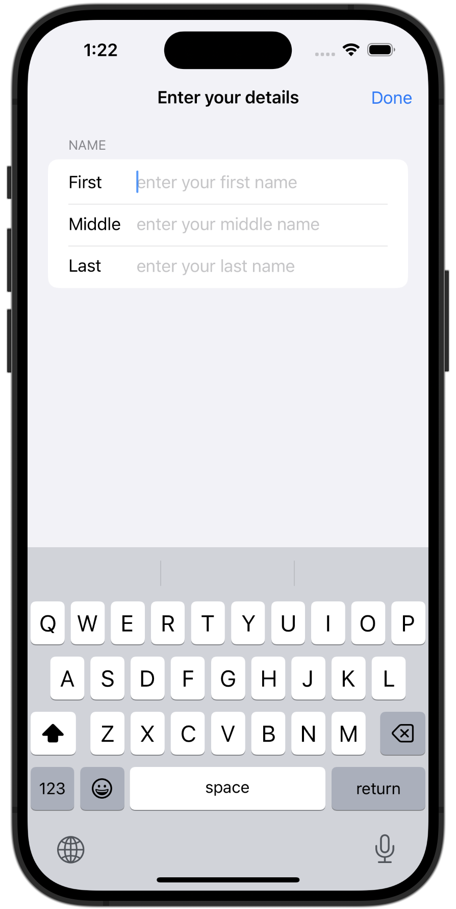
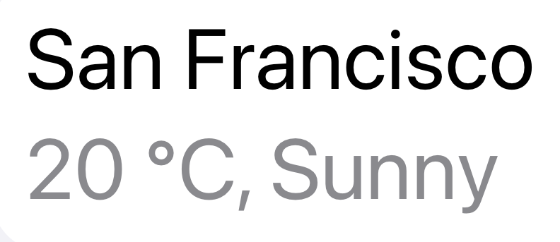
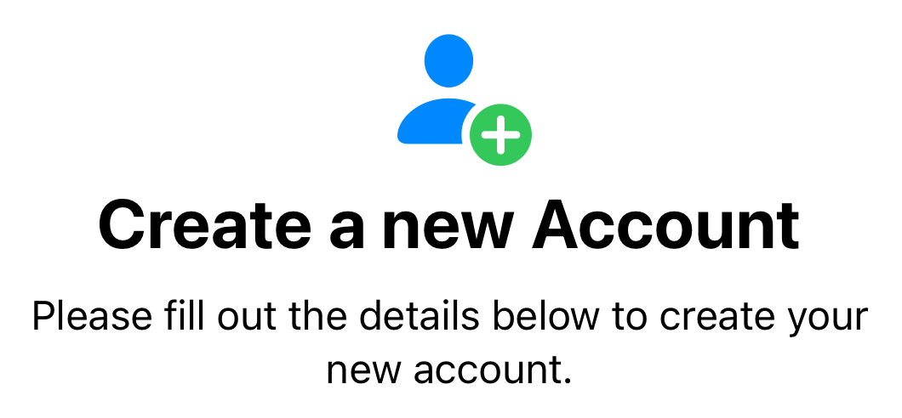
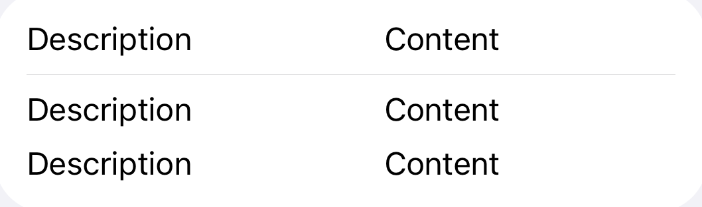
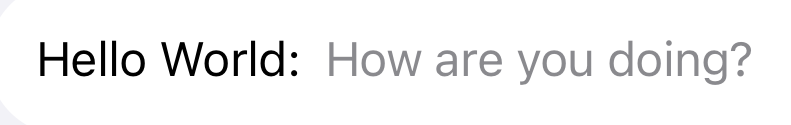
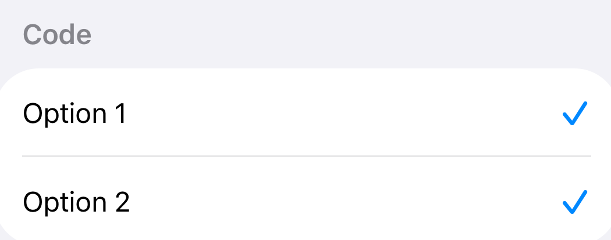

<!--

This source file is part of the Stanford Spezi open-source project.

SPDX-FileCopyrightText: 2022 Stanford University and the project authors (see CONTRIBUTORS.md)

SPDX-License-Identifier: MIT
  
-->

# Spezi Views

[](https://github.com/StanfordSpezi/SpeziViews/actions/workflows/ci.yml)
[](https://codecov.io/gh/StanfordSpezi/SpeziViews)
[](https://doi.org/10.5281/zenodo.7806475)
[](https://swiftpackageindex.com/StanfordSpezi/SpeziViews)
[](https://swiftpackageindex.com/StanfordSpezi/SpeziViews)

SwiftUI views that you can use right away in your app: buttons that run tasks and report errors, forms that check what the user types, name fields, step-by-step flows such as an onboarding, and layouts that adapt to the user's text size.

SpeziViews is part of the [Stanford Spezi](https://github.com/StanfordSpezi) ecosystem, but its views work in any SwiftUI app.

## What's Inside

The package contains three libraries. Add the ones you need to your app.

| Library | Use it to |
|:--|:--|
| [SpeziViews](https://swiftpackageindex.com/stanfordspezi/speziviews/documentation/speziviews) | Run tasks from buttons, show progress and errors, build step-by-step flows, and lay out content. |
| [SpeziPersonalInfo](https://swiftpackageindex.com/stanfordspezi/speziviews/documentation/spezipersonalinfo) | Ask for a person's name and show their profile picture. |
| [SpeziValidation](https://swiftpackageindex.com/stanfordspezi/speziviews/documentation/spezivalidation) | Check what the user types, for example an email address, and tell them if something is wrong. |

## Installation

### In an Xcode Project

1. In Xcode, choose **File > Add Package Dependencies…**
2. Enter `https://github.com/StanfordSpezi/SpeziViews` in the search field.
3. Select **Add Package**, then choose the libraries you need and add them to your app target.

### In a Swift Package

Add SpeziViews to the dependencies in your `Package.swift` file:

```swift
dependencies: [
    .package(url: "https://github.com/StanfordSpezi/SpeziViews.git", from: "1.12.0")
]
```

Then add the libraries you need to your target:

```swift
.target(
    name: "MyFeature",
    dependencies: [
        .product(name: "SpeziViews", package: "SpeziViews")
    ]
)
```

> [!NOTE]
> The [`ConfigureTipKit`](https://swiftpackageindex.com/stanfordspezi/speziviews/documentation/speziviews/configuretipkit) module requires Spezi. If your app doesn't use Spezi yet, follow the [Spezi setup article](https://swiftpackageindex.com/stanfordspezi/spezi/documentation/spezi/initial-setup). All other components work without it.

## Quick Start

### Run a task when a button is tapped

Use an `AsyncButton` for work that takes a moment, such as sending a request to a server.

<table>
<tr>
<td>

```swift
import SpeziViews
import SwiftUI


struct ResetPasswordView: View {
    @State private var viewState: ViewState = .idle

    var body: some View {
        AsyncButton("Reset Password", state: $viewState) {
            try await sendResetEmail()
        }
            .viewStateAlert(state: $viewState)
    }

    private func sendResetEmail() async throws {
        // Send the request ...
    }
}
```

</td>
<td width="280" align="center">

<picture><source media="(prefers-color-scheme: dark)" srcset="Sources/SpeziViews/SpeziViews.docc/Resources/ViewState~dark.png"></picture>

</td>
</tr>
</table>

- `ViewState` keeps track of whether the view is idle, busy, or ran into an error.
- `AsyncButton` shows a progress indicator while your code runs, and prevents the user from tapping the button twice.
- If your code throws an error, `viewStateAlert(state:)` shows it to the user in an alert.

### Ask for a person's name

Use `NameFieldRow`s inside a `Grid` to show a label in front of each text field.

<table>
<tr>
<td>

```swift
import SpeziPersonalInfo
import SwiftUI


struct NameView: View {
    @State private var name = PersonNameComponents()

    var body: some View {
        Form {
            Grid {
                NameFieldRow("First", name: $name, for: \.givenName) {
                    Text("enter your first name")
                }
                Divider()
                    .gridCellUnsizedAxes(.horizontal)
                NameFieldRow("Last", name: $name, for: \.familyName) {
                    Text("enter your last name")
                }
            }
        }
    }
}
```

</td>
<td width="280" align="center">

<picture><source media="(prefers-color-scheme: dark)" srcset="Sources/SpeziPersonalInfo/SpeziPersonalInfo.docc/Resources/NameFields~dark.png"></picture>

</td>
</tr>
</table>

- The name is stored as a [`PersonNameComponents`](https://developer.apple.com/documentation/foundation/personnamecomponents) value.
- Each field tells the system what it contains, so the keyboard can suggest the user's name with AutoFill.

### Check what the user types

Use a `VerifiableTextField` with validation rules to show a message below the text field when the input isn't valid.

<table>
<tr>
<td>

```swift
import SpeziValidation
import SwiftUI


struct SignUpView: View {
    @State private var email = ""
    @State private var password = ""
    @ValidationState private var validation

    var body: some View {
        Form {
            VerifiableTextField("Email", text: $email)
                .validate(input: email, rules: .minimalEmail)
            VerifiableTextField("Password", text: $password, type: .secure)
                .validate(input: password, rules: .minimalPassword)

            Button("Sign Up") {
                guard validation.validateSubviews() else {
                    return // Shows the error messages.
                }
                // All input is valid ...
            }
        }
            .receiveValidation(in: $validation)
    }
}
```

</td>
<td width="280" align="center">

<picture><source media="(prefers-color-scheme: dark)" srcset="Sources/SpeziValidation/SpeziValidation.docc/Resources/Validation~dark.png"></picture>

</td>
</tr>
</table>

- Each text field checks its input against the rules you pass to `validate(input:rules:)`.
- `@ValidationState` and `receiveValidation(in:)` collect the results of all text fields, so you can check the whole form when the user taps a button.
- You can also [write your own rules](https://swiftpackageindex.com/stanfordspezi/speziviews/documentation/spezivalidation/validationrule).

## Components

Here is everything the package offers. Select a name to open its documentation, which includes more examples.

### SpeziViews

| <picture><source media="(prefers-color-scheme: dark)" srcset="Sources/SpeziViews/SpeziViews.docc/Resources/ViewState~dark.png"></picture> | <picture><source media="(prefers-color-scheme: dark)" srcset="Sources/SpeziViews/SpeziViews.docc/Resources/Tile-Leading~dark.png"></picture> | <picture><source media="(prefers-color-scheme: dark)" srcset="Sources/SpeziViews/SpeziViews.docc/Resources/Skeleton-Loading-Animation~dark.gif"></picture> |
|:--:|:--:|:--:|
| [`ViewState`](https://swiftpackageindex.com/stanfordspezi/speziviews/documentation/speziviews/viewstate) and `viewStateAlert(state:)` | [`SimpleTile`](https://swiftpackageindex.com/stanfordspezi/speziviews/documentation/speziviews/simpletile) and [`TileHeader`](https://swiftpackageindex.com/stanfordspezi/speziviews/documentation/speziviews/tileheader) | The `skeletonLoading` modifier |
|  |  |  |
| [`ListRow`](https://swiftpackageindex.com/stanfordspezi/speziviews/documentation/speziviews/listrow) | [`ListRow`](https://swiftpackageindex.com/stanfordspezi/speziviews/documentation/speziviews/listrow) at an accessibility text size | [`ListHeader`](https://swiftpackageindex.com/stanfordspezi/speziviews/documentation/speziviews/listheader) |
|  |  |  |
| [`DescriptionGridRow`](https://swiftpackageindex.com/stanfordspezi/speziviews/documentation/speziviews/descriptiongridrow) | [`DynamicHStack`](https://swiftpackageindex.com/stanfordspezi/speziviews/documentation/speziviews/dynamichstack) | [`CaseIterablePicker`](https://swiftpackageindex.com/stanfordspezi/speziviews/documentation/speziviews/caseiterablepicker) |
|  |  |  |
| [`OptionSetPicker`](https://swiftpackageindex.com/stanfordspezi/speziviews/documentation/speziviews/optionsetpicker) | [`InfoButton`](https://swiftpackageindex.com/stanfordspezi/speziviews/documentation/speziviews/infobutton) | [`DismissButton`](https://swiftpackageindex.com/stanfordspezi/speziviews/documentation/speziviews/dismissbutton) |

| Component | What it does |
|:--|:--|
| [`ViewState`](https://swiftpackageindex.com/stanfordspezi/speziviews/documentation/speziviews/viewstate), [`OperationState`](https://swiftpackageindex.com/stanfordspezi/speziviews/documentation/speziviews/operationstate) | Track whether a view is idle, processing, or failed, and present errors to the user with the `viewStateAlert(state:)` modifier. |
| [`AsyncButton`](https://swiftpackageindex.com/stanfordspezi/speziviews/documentation/speziviews/asyncbutton) | A button that runs an asynchronous, throwing action. It shows a progress indicator while the action runs and reports errors through a `ViewState`. |
| [`ManagedNavigationStack`](https://swiftpackageindex.com/stanfordspezi/speziviews/documentation/speziviews/managednavigationstack) | A `NavigationStack` for multi-step flows such as an onboarding: declare all steps, including conditional ones, in one place and advance with `nextStep()` instead of wiring up each destination. |
| [`SimpleTile`](https://swiftpackageindex.com/stanfordspezi/speziviews/documentation/speziviews/simpletile), [`TileHeader`](https://swiftpackageindex.com/stanfordspezi/speziviews/documentation/speziviews/tileheader), [`CompletedTileHeader`](https://swiftpackageindex.com/stanfordspezi/speziviews/documentation/speziviews/completedtileheader) | Card-style tiles with a header, body, and footer. |
| [`ListRow`](https://swiftpackageindex.com/stanfordspezi/speziviews/documentation/speziviews/listrow) | A key-value list row. For accessibility text sizes, it stacks the value below the label. |
| [`ListHeader`](https://swiftpackageindex.com/stanfordspezi/speziviews/documentation/speziviews/listheader) | A header with an image, a title, and instructions, for example at the top of a form. |
| [`DescriptionGridRow`](https://swiftpackageindex.com/stanfordspezi/speziviews/documentation/speziviews/descriptiongridrow), [`DynamicHStack`](https://swiftpackageindex.com/stanfordspezi/speziviews/documentation/speziviews/dynamichstack) | Layouts that adapt to Dynamic Type sizes, device orientation, and size classes, for example by wrapping horizontal content onto the next line when there isn't enough space. |
| [`CaseIterablePicker`](https://swiftpackageindex.com/stanfordspezi/speziviews/documentation/speziviews/caseiterablepicker), [`OptionSetPicker`](https://swiftpackageindex.com/stanfordspezi/speziviews/documentation/speziviews/optionsetpicker) | Pickers that derive their options from a `CaseIterable` enum or an `OptionSet`. |
| [`CanvasView`](https://swiftpackageindex.com/stanfordspezi/speziviews/documentation/speziviews/canvasview) | A PencilKit canvas, for example to collect a signature. |
| [`InfoButton`](https://swiftpackageindex.com/stanfordspezi/speziviews/documentation/speziviews/infobutton), [`DismissButton`](https://swiftpackageindex.com/stanfordspezi/speziviews/documentation/speziviews/dismissbutton) | An icon-only info button, for example for the trailing side of a list row, and a dismiss button. |
| `shareSheet(item:)`, [`ShareSheetInput`](https://swiftpackageindex.com/stanfordspezi/speziviews/documentation/speziviews/sharesheetinput) | Present the system share sheet from a binding, for the cases where SwiftUI's [`ShareLink`](https://developer.apple.com/documentation/swiftui/sharelink) falls short. |
| [`MarkdownView`](https://swiftpackageindex.com/stanfordspezi/speziviews/documentation/speziviews/markdownview), [`LazyText`](https://swiftpackageindex.com/stanfordspezi/speziviews/documentation/speziviews/lazytext) | Render Markdown content and display long, multi-line text efficiently. |
| `skeletonLoading(replicationCount:repeatInterval:spacing:)`, `shimmer(repeatInterval:)`, `processingOverlay(isProcessing:overlay:)` | Visual effects that communicate that content is loading. |

### SpeziPersonalInfo

| Component | What it does |
|:--|:--|
| [`NameFieldRow`](https://swiftpackageindex.com/stanfordspezi/speziviews/documentation/spezipersonalinfo/namefieldrow), [`NameTextField`](https://swiftpackageindex.com/stanfordspezi/speziviews/documentation/spezipersonalinfo/nametextfield) | Text fields to enter the components of a `PersonNameComponents` value. Each field sets the matching text content type so that the system can offer AutoFill. |
| [`UserProfileView`](https://swiftpackageindex.com/stanfordspezi/speziviews/documentation/spezipersonalinfo/userprofileview) | Displays a person's profile image in a circle, or their initials if no image is available. |

### SpeziValidation

| Component | What it does |
|:--|:--|
| [`ValidationRule`](https://swiftpackageindex.com/stanfordspezi/speziviews/documentation/spezivalidation/validationrule) | A rule that validates a `String` input. Comes with built-in rules such as `nonEmpty`, `minimalEmail`, and `minimalPassword`. |
| `validate(input:rules:)` | Validates an input against one or more validation rules. |
| [`VerifiableTextField`](https://swiftpackageindex.com/stanfordspezi/speziviews/documentation/spezivalidation/verifiabletextfield), [`ValidationResultsView`](https://swiftpackageindex.com/stanfordspezi/speziviews/documentation/spezivalidation/validationresultsview) | Display validation errors below a text field. |
| [`ValidationState`](https://swiftpackageindex.com/stanfordspezi/speziviews/documentation/spezivalidation/validationstate), `receiveValidation(in:)` | Collect the validation state of all subviews, for example to validate a whole form when the user taps a submit button. |

## Learn More

The documentation of each library explains its concepts in more detail and contains more examples:

- [SpeziViews documentation](https://swiftpackageindex.com/stanfordspezi/speziviews/documentation/speziviews)
- [SpeziPersonalInfo documentation](https://swiftpackageindex.com/stanfordspezi/speziviews/documentation/spezipersonalinfo)
- [SpeziValidation documentation](https://swiftpackageindex.com/stanfordspezi/speziviews/documentation/spezivalidation)

## Contributing

Contributions to this project are welcome. Please make sure to read the [contribution guidelines](https://github.com/StanfordSpezi/.github/blob/main/CONTRIBUTING.md) and the [contributor covenant code of conduct](https://github.com/StanfordSpezi/.github/blob/main/CODE_OF_CONDUCT.md) first.

## License

This project is licensed under the MIT License. See [Licenses](https://github.com/StanfordSpezi/SpeziViews/tree/main/LICENSES) for more information.


