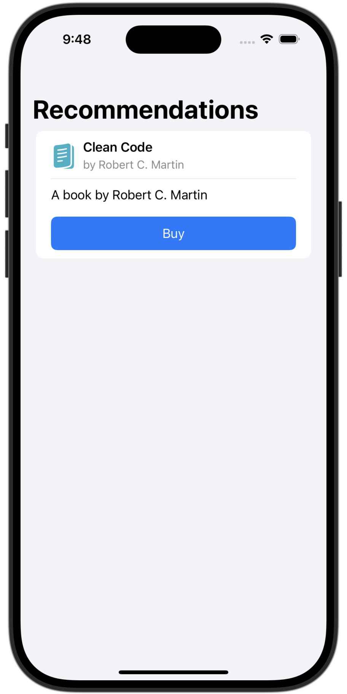
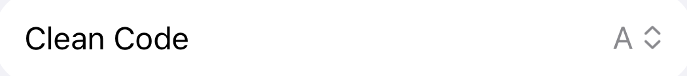
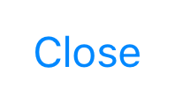
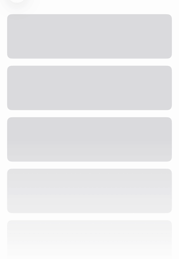
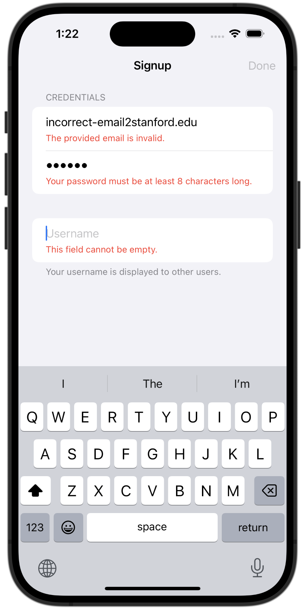

<!--

This source file is part of the Stanford Spezi open-source project.

SPDX-FileCopyrightText: 2022 Stanford University and the project authors (see CONTRIBUTORS.md)

SPDX-License-Identifier: MIT
  
-->

# Spezi Views

[](https://github.com/StanfordSpezi/SpeziViews/actions/workflows/ci.yml)
[](https://codecov.io/gh/StanfordSpezi/SpeziViews)
[](https://doi.org/10.5281/zenodo.7806475)
[](https://swiftpackageindex.com/StanfordSpezi/SpeziViews)
[](https://swiftpackageindex.com/StanfordSpezi/SpeziViews)

A Spezi framework that provides a common set of SwiftUI views and related functionality used across the Spezi ecosystem.

## Overview

SpeziViews provides easy-to-use and easily-reusable UI components that makes the everyday life of developing Spezi applications easier.
The package consists of three targets:

- [SpeziViews](https://swiftpackageindex.com/stanfordspezi/speziviews/documentation/speziviews): UI components to manage view state, run asynchronous actions, lay out content, and build multi-step navigation flows.
- [SpeziPersonalInfo](https://swiftpackageindex.com/stanfordspezi/speziviews/documentation/spezipersonalinfo): Components to display and collect personal information, such as a person's name.
- [SpeziValidation](https://swiftpackageindex.com/stanfordspezi/speziviews/documentation/spezivalidation): Rule-based input validation that shows validation feedback to the user.

| | |   |
|:--:|:--:|:--:|
|Easily manage view state and display erroneous state using [`ViewState`](https://swiftpackageindex.com/stanfordspezi/speziviews/documentation/speziviews/viewstate). |The [SpeziPersonalInfo](https://swiftpackageindex.com/stanfordspezi/speziviews/documentation/spezipersonalinfo) provides easy to use abstractions for dealing with personal information. |Perform and visualize input validation with ease using [SpeziValidation](https://swiftpackageindex.com/stanfordspezi/speziviews/documentation/spezivalidation).|

## Setup

You need to add the SpeziViews Swift package to
[your app in Xcode](https://developer.apple.com/documentation/xcode/adding-package-dependencies-to-your-app#) or
[Swift package](https://developer.apple.com/documentation/xcode/creating-a-standalone-swift-package-with-xcode#Add-a-dependency-on-another-Swift-package).

> [!IMPORTANT]  
> If your application is not yet configured to use Spezi, follow the [Spezi setup article](https://swiftpackageindex.com/stanfordspezi/spezi/documentation/spezi/initial-setup) to set up the core Spezi infrastructure.

## Getting Started

The following example runs an asynchronous, throwing action when the user taps a button.
The [`AsyncButton`](https://swiftpackageindex.com/stanfordspezi/speziviews/documentation/speziviews/asyncbutton) shows a progress indicator while the action runs,
and the `viewStateAlert(state:)` modifier presents an alert if the action throws an error.

```swift
import SpeziViews
import SwiftUI


struct SyncView: View {
    @State private var viewState: ViewState = .idle

    var body: some View {
        AsyncButton("Sync Data", state: $viewState) {
            try await sync()
        }
            .viewStateAlert(state: $viewState)
    }

    private func sync() async throws {
        // ...
    }
}
```

The documentation of each target explains its core concepts and contains further examples:
[SpeziViews](https://swiftpackageindex.com/stanfordspezi/speziviews/documentation/speziviews),
[SpeziPersonalInfo](https://swiftpackageindex.com/stanfordspezi/speziviews/documentation/spezipersonalinfo), and
[SpeziValidation](https://swiftpackageindex.com/stanfordspezi/speziviews/documentation/spezivalidation).

## Components

The tables below list the components of each target. Follow the links to their documentation for examples and details.

### SpeziViews

| Component | Description | Preview |
|:--|:--|:--:|
| [`ViewState`](https://swiftpackageindex.com/stanfordspezi/speziviews/documentation/speziviews/viewstate), [`OperationState`](https://swiftpackageindex.com/stanfordspezi/speziviews/documentation/speziviews/operationstate) | Track whether a view is idle, processing, or failed, and present errors to the user with the `viewStateAlert(state:)` modifier. | <picture><source media="(prefers-color-scheme: dark)" srcset="Sources/SpeziViews/SpeziViews.docc/Resources/ViewState~dark.png"></picture> |
| [`AsyncButton`](https://swiftpackageindex.com/stanfordspezi/speziviews/documentation/speziviews/asyncbutton) | A button that runs an asynchronous, throwing action. It shows a progress indicator while the action runs and reports errors through a `ViewState`. |  |
| [`ManagedNavigationStack`](https://swiftpackageindex.com/stanfordspezi/speziviews/documentation/speziviews/managednavigationstack) | A `NavigationStack` for multi-step flows such as an onboarding: declare all steps, including conditional ones, in one place and advance with `nextStep()` instead of wiring up each destination. |  |
| [`SimpleTile`](https://swiftpackageindex.com/stanfordspezi/speziviews/documentation/speziviews/simpletile), [`TileHeader`](https://swiftpackageindex.com/stanfordspezi/speziviews/documentation/speziviews/tileheader), [`CompletedTileHeader`](https://swiftpackageindex.com/stanfordspezi/speziviews/documentation/speziviews/completedtileheader) | Card-style tiles with a header, body, and footer. | <picture><source media="(prefers-color-scheme: dark)" srcset="Sources/SpeziViews/SpeziViews.docc/Resources/Tile-Leading~dark.png"></picture> |
| [`ListRow`](https://swiftpackageindex.com/stanfordspezi/speziviews/documentation/speziviews/listrow) | A key-value list row. For accessibility text sizes, it stacks the value below the label. | <br> |
| [`ListHeader`](https://swiftpackageindex.com/stanfordspezi/speziviews/documentation/speziviews/listheader) | A header with an image, a title, and instructions, for example at the top of a form. |  |
| [`DescriptionGridRow`](https://swiftpackageindex.com/stanfordspezi/speziviews/documentation/speziviews/descriptiongridrow), [`DynamicHStack`](https://swiftpackageindex.com/stanfordspezi/speziviews/documentation/speziviews/dynamichstack) | Layouts that adapt to Dynamic Type sizes, device orientation, and size classes, for example by wrapping horizontal content onto the next line when there isn't enough space. | <br> |
| [`CaseIterablePicker`](https://swiftpackageindex.com/stanfordspezi/speziviews/documentation/speziviews/caseiterablepicker), [`OptionSetPicker`](https://swiftpackageindex.com/stanfordspezi/speziviews/documentation/speziviews/optionsetpicker) | Pickers that derive their options from a `CaseIterable` enum or an `OptionSet`. | <br> |
| [`CanvasView`](https://swiftpackageindex.com/stanfordspezi/speziviews/documentation/speziviews/canvasview) | A PencilKit canvas, for example to collect a signature. |  |
| [`InfoButton`](https://swiftpackageindex.com/stanfordspezi/speziviews/documentation/speziviews/infobutton), [`DismissButton`](https://swiftpackageindex.com/stanfordspezi/speziviews/documentation/speziviews/dismissbutton) | An icon-only info button, for example for the trailing side of a list row, and a dismiss button. |   |
| `shareSheet(item:)`, [`ShareSheetInput`](https://swiftpackageindex.com/stanfordspezi/speziviews/documentation/speziviews/sharesheetinput) | Present the system share sheet from a binding, for the cases where SwiftUI's [`ShareLink`](https://developer.apple.com/documentation/swiftui/sharelink) falls short. |  |
| [`MarkdownView`](https://swiftpackageindex.com/stanfordspezi/speziviews/documentation/speziviews/markdownview), [`LazyText`](https://swiftpackageindex.com/stanfordspezi/speziviews/documentation/speziviews/lazytext) | Render Markdown content and display long, multi-line text efficiently. |  |
| `skeletonLoading(replicationCount:repeatInterval:spacing:)`, `shimmer(repeatInterval:)`, `processingOverlay(isProcessing:overlay:)` | Visual effects that communicate that content is loading. | <picture><source media="(prefers-color-scheme: dark)" srcset="Sources/SpeziViews/SpeziViews.docc/Resources/Skeleton-Loading-Animation~dark.gif"></picture> |

### SpeziPersonalInfo

| Component | Description | Preview |
|:--|:--|:--:|
| [`NameFieldRow`](https://swiftpackageindex.com/stanfordspezi/speziviews/documentation/spezipersonalinfo/namefieldrow), [`NameTextField`](https://swiftpackageindex.com/stanfordspezi/speziviews/documentation/spezipersonalinfo/nametextfield) | Text fields to enter the components of a `PersonNameComponents` value. Each field sets the matching text content type so that the system can offer AutoFill. | <picture><source media="(prefers-color-scheme: dark)" srcset="Sources/SpeziPersonalInfo/SpeziPersonalInfo.docc/Resources/NameFields~dark.png"></picture> |
| [`UserProfileView`](https://swiftpackageindex.com/stanfordspezi/speziviews/documentation/spezipersonalinfo/userprofileview) | Displays a person's profile image in a circle, or their initials if no image is available. |  |

### SpeziValidation

| Component | Description | Preview |
|:--|:--|:--:|
| [`ValidationRule`](https://swiftpackageindex.com/stanfordspezi/speziviews/documentation/spezivalidation/validationrule) | A rule that validates a `String` input. Comes with built-in rules such as `nonEmpty`, `minimalEmail`, and `minimalPassword`. |  |
| `validate(input:rules:)` | Validates an input against one or more validation rules. |  |
| [`VerifiableTextField`](https://swiftpackageindex.com/stanfordspezi/speziviews/documentation/spezivalidation/verifiabletextfield), [`ValidationResultsView`](https://swiftpackageindex.com/stanfordspezi/speziviews/documentation/spezivalidation/validationresultsview) | Display validation errors below a text field. | <picture><source media="(prefers-color-scheme: dark)" srcset="Sources/SpeziValidation/SpeziValidation.docc/Resources/Validation~dark.png"></picture> |
| [`ValidationState`](https://swiftpackageindex.com/stanfordspezi/speziviews/documentation/spezivalidation/validationstate), `receiveValidation(in:)` | Collect the validation state of all subviews, for example to validate a whole form when the user taps a submit button. |  |

For more information, please refer to the [API documentation](https://swiftpackageindex.com/stanfordspezi/speziviews/documentation).

## Contributing

Contributions to this project are welcome. Please make sure to read the [contribution guidelines](https://github.com/StanfordSpezi/.github/blob/main/CONTRIBUTING.md) and the [contributor covenant code of conduct](https://github.com/StanfordSpezi/.github/blob/main/CODE_OF_CONDUCT.md) first.

## License

This project is licensed under the MIT License. See [Licenses](https://github.com/StanfordSpezi/SpeziViews/tree/main/LICENSES) for more information.


